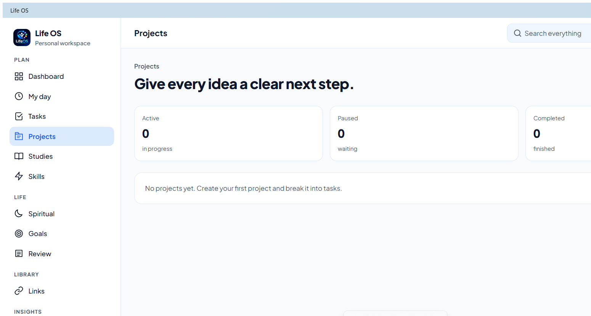

<div align="center">

# Life OS

**A personal planner for Windows — tasks, projects, studies, skills, goals and daily prayers, all in one private place.**

[](https://github.com/ahsanamingorsi/Life-OS/releases/latest/download/LifeOS-Setup.exe)
[](https://github.com/ahsanamingorsi/Life-OS/releases/latest)
[](LICENSE)

No account. No login. No cloud. Everything stays on your own PC.

</div>

---

## Screenshot



## Features

- **Dashboard** — today's productivity score, today's tasks, prayers, a 7-day chart, projects in focus and what needs your attention.
- **My day** — pick any day and see its tasks and repeated tasks.
- **Tasks** — one-time tasks and repeated tasks (daily, weekly on chosen days, monthly), with an optional end date, streaks and history.
- **Goals** — link tasks to a goal; progress is calculated from those tasks (or set by hand when no task is linked).
- **Projects** — a simple board (To do, In progress, Done), time logging and automatic progress.
- **Studies** — subjects with target hours, weekly targets, study sessions, notes and subject tasks.
- **Skills** — skills you are learning, hours per week, progress and a current skill.
- **Spiritual** — each of the five daily prayers, gratitude and reflection notes, a 30-day calendar and a streak.
- **Review, Links, Analytics and Search.**
- **Backup** — export all your data to a file and import it on another PC.
- Light and dark mode, and a focus timer.

### How the productivity score works

The daily score is the equal average of the areas that had something to measure that day: Tasks, Projects, Studies, Skills and Spiritual. Goals and Review are shown as weekly cards and are not part of the daily score.

## Install

1. Click **Download** above, or open [**Releases**](https://github.com/ahsanamingorsi/Life-OS/releases/latest) and get `LifeOS-Setup.exe`.
2. Run it. Because the installer is not signed with a paid certificate, Windows may show **"Windows protected your PC"**. Click **More info → Run anyway**.
3. Open **Life OS** from the Start menu or the desktop icon.

Requirements: Windows 10 (version 2004 / build 19041) or newer, 64-bit. Nothing else needs to be installed — the app includes everything it needs.

### Your data

- Your data is stored only on your PC, in your Windows user's `AppData\Local` folder.
- Uninstalling Life OS does **not** delete your data.
- To move your data to another PC, use **Settings → Export**, copy the file, then **Settings → Import** on the other PC.

## Build from source

Requirements:

- Windows 10/11
- [.NET 10 SDK](https://dotnet.microsoft.com/download) (or newer) with the **.NET MAUI** workload (`dotnet workload install maui-windows`)
- Optional: [Inno Setup](https://jrsoftware.org/isinfo.php) to build the installer

```powershell
git clone https://github.com/ahsanamingorsi/Life-OS.git
cd Life-OS
dotnet build LifeOS.App/LifeOS.App.csproj -f net10.0-windows10.0.19041.0
```

Run the app from Visual Studio (set **LifeOS.App** as the startup project and choose **Windows Machine**), or start the built `LifeOS.App.exe`.

### Build the installer

```powershell
dotnet publish LifeOS.App/LifeOS.App.csproj -f net10.0-windows10.0.19041.0 -c Release -r win-x64 --self-contained true -p:WindowsAppSDKSelfContained=true -o publish/app
ISCC.exe installer/LifeOS.iss
```

The installer is written to `publish/installer/LifeOS-Setup.exe`.

## Project structure

| Folder | What it contains |
| --- | --- |
| `LifeOS.Core` | Data models, the database context and the shared logic (tasks, goals, scores, dashboard). |
| `LifeOS.Data.Sqlite` | The local SQLite database setup and its migrations. |
| `LifeOS.App` | The Windows app (.NET MAUI Blazor Hybrid): pages, layout and styles. |
| `installer` | The Inno Setup script for `LifeOS-Setup.exe`. |

Database changes: add a migration with

```powershell
cd LifeOS.Data.Sqlite
dotnet tool restore
dotnet tool run dotnet-ef migrations add <Name> --output-dir Migrations
```

The app applies new migrations automatically when it starts.

## Developer

Built by **Ahsan Amin Gorsi**.

[](https://ahsanamingorsi.com)
[](https://github.com/ahsanamingorsi)
[](https://linkedin.com/in/ahsanamingorsi)
[](https://instagram.com/ahsanamingorsi)
[](https://x.com/ahsanamingorsi)

## License

[MIT](LICENSE)
